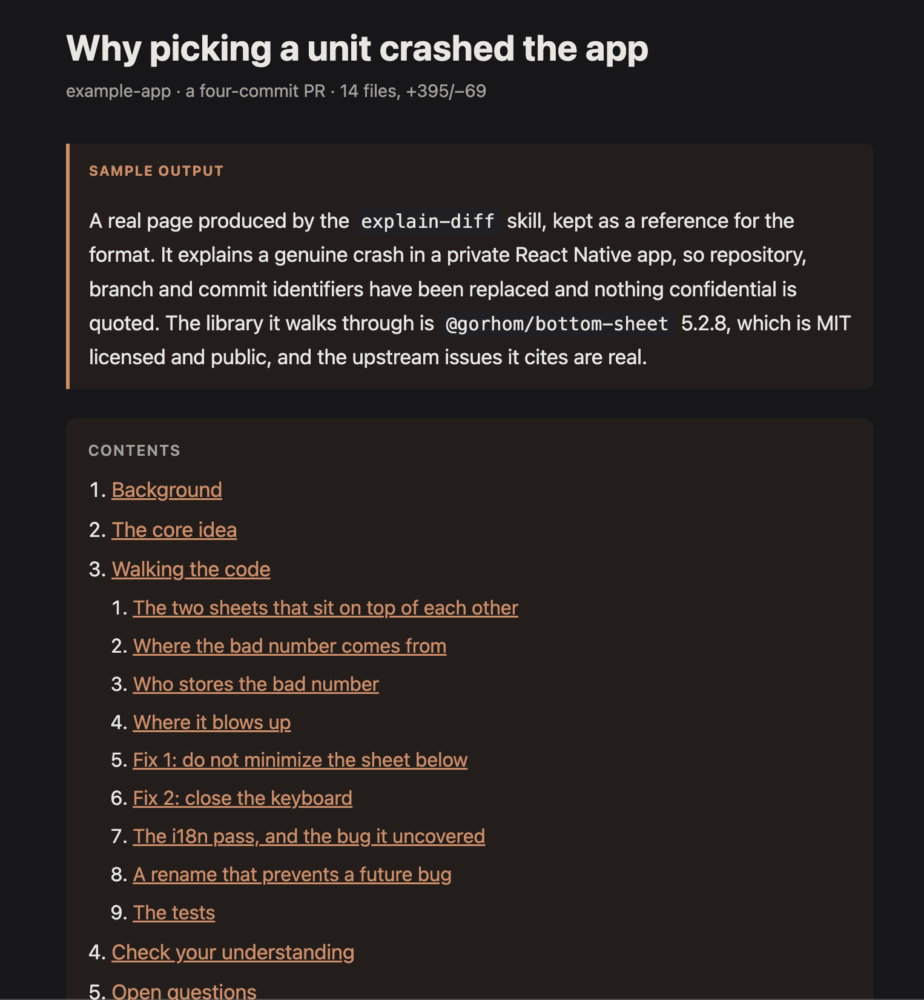
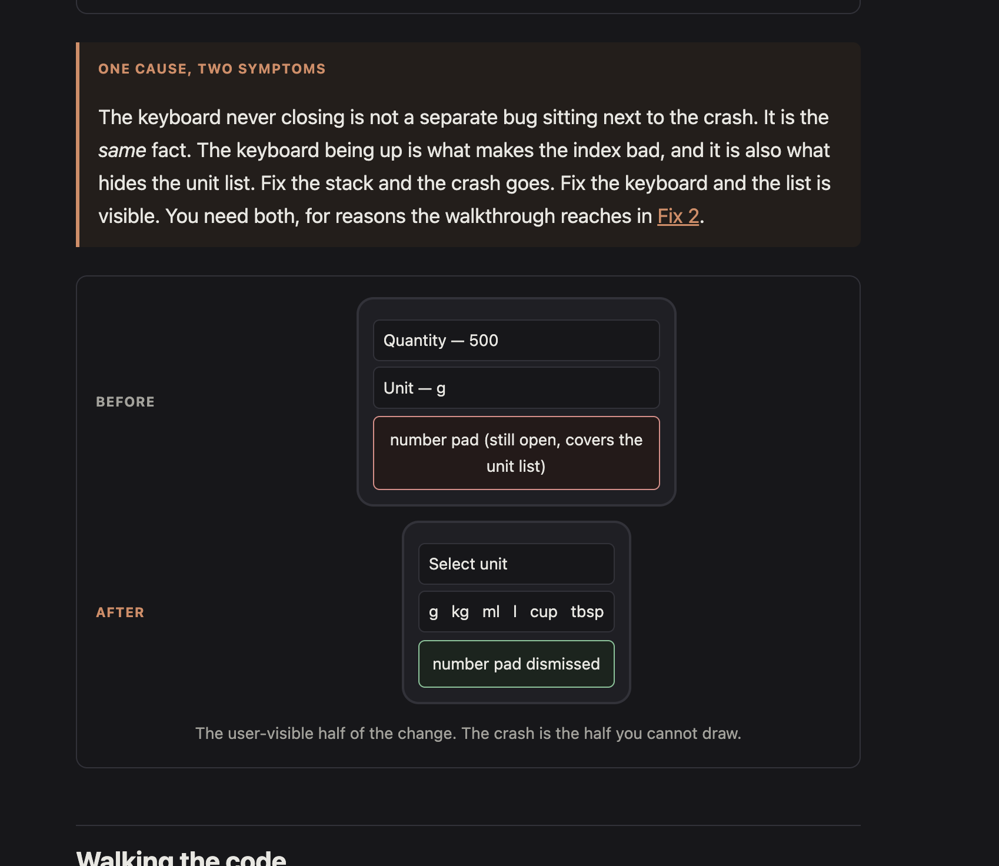
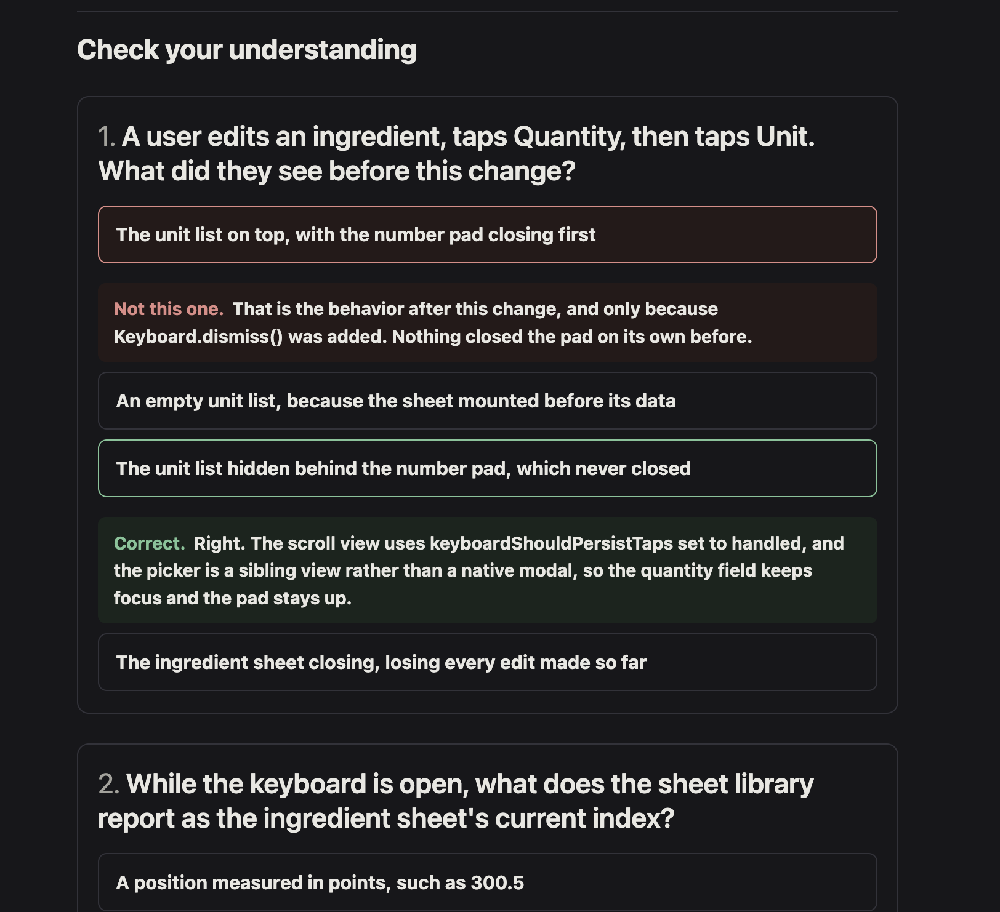

# explain-diff

Turns a diff, branch or PR into a single self-contained HTML page that explains the
change and then quizzes you on it. It gets read on a phone, days later, by someone
who wasn't in the room when the change was decided.

Based on [Geoffrey Litt's `explain-diff-html`
gist](https://gist.github.com/geoffreylitt/a29df1b5f9865506e8952488eac3d524) — the
structure, the single-file output, the prose style and the no-ASCII-diagrams rule
are his. His gist also has an `explain-diff-notion` variant that writes to a Notion
page; if that suits you better, use his.

```
npx skills@latest add lucaslimafons/skills/explain-diff
```

Then ask for a change to be explained: *"explain PR #225"*, *"walk me through this
diff"*, *"onboard me onto this change"*.

## What it looks like

A complete generated page is kept at
[`examples/sample-explainer.html`](examples/sample-explainer.html). It explains a
real crash in a React Native app, where tapping a unit picker while the number pad
was open crashed the screen. Repository, branch and commit identifiers have been
replaced and nothing confidential is quoted; the library it walks through,
`@gorhom/bottom-sheet`, is MIT licensed and public.

GitHub shows an HTML file as source rather than rendering it, so download the file
and open it in a browser to click through the quiz. The screenshots below are the
quick version.

| | |
| --- | --- |
|  | **Opening.** A one-line title that says what changed, a byline carrying the size of the diff, and a table of contents that reaches the subsections of the walkthrough. |
|  | **Explaining.** Callouts carry the ideas worth stopping on. Diagrams are built from HTML boxes and carry real example data, never a box labelled "Server". |
|  | **Checking.** Options are reordered on every page load. The reasoning lives in the feedback you see after answering, which is what stops the correct option being the longest. |

That page is also a conformance test. It passes `scripts/verify.mjs` with no
failures, holds to five questions, and averages 13.7 words per sentence.

## What you get

One HTML file, written outside the repo with a dated filename, that opens with no
server and no network. Inside it:

- **Background** in two tiers — the narrow context the change needs, plus a deeper
  tier in a collapsed block for someone new to the subsystem.
- **The core idea**, with diagrams built from HTML boxes and carrying real example
  data. `join_code=A4F2, via=ticket` explains something; a box labelled "Server"
  decorates.
- **A code walkthrough**, grouped so it builds rather than following the diff's file
  order, with every claim cited to a `path/to/file.ts:42`.
- **A quiz** sized to the change, which is the part below.
- **Open questions**, when the change leaves a real gap: a rationale that couldn't
  be recovered, something untested, a deferred follow-up.

## Why the quiz was rebuilt

A model writing a multiple-choice question reaches for the answer first, writes it
as a complete true statement with its reasoning attached, then invents three short
false ones to sit beside it. Nothing in that is wrong on its face, and the result
is a quiz you can ace without reading a line of the diff.

Two tells come out of it:

- **The answer is the longest option**, because it is the only one carrying a
  mechanism and a reason.
- **The answer drifts to the same slot**, usually the second, because that is where
  "write the answer, then pad around it" tends to land it.

Both are fixed, in different places, because they are not the same kind of problem.
The useful way to read the fixes is by how strong a guarantee each one buys:

| | Fix | Why that tier |
| --- | --- | --- |
| **Made impossible** | Options are shuffled in the browser on every page load | Position is a fact about the rendered page, so the page owns it. Authoring order carries no information, so there is nothing left to get wrong |
| **Removed at the source** | The option asserts; the feedback explains | "Because…" is what made the key long. Moved into a `why` field the reader sees only after answering, the asymmetry has no cause rather than being suppressed |
| **Caught by a check** | A 1.3x cap on the option word-count spread | A model can always write a long option, so this one can't be made impossible. It is measured from outside the finished document and fails the build |

The shuffle is a Fisher-Yates on a copy of the options array, and it was measured
rather than assumed: executing the real renderer against a DOM stub over 4000
renders, the correct option landed in the four slots 997 / 1011 / 985 / 1007 times
(max/min 1.026).

Two consequences worth knowing if you write a quiz by hand:

- **Never refer to an option by letter or position.** "As the second choice showed"
  is wrong the moment the page loads, and `scripts/verify.mjs` greps for that shape.
- **The quiz has to stay data.** The template holds questions in a plain `const QUIZ`
  array, which is what lets a terminal script parse option lengths back out of the
  finished file. A hand-rolled quiz written straight into HTML has no lengths to
  read, so the audit silently stops applying — which is why its absence is now a
  hard failure rather than a warning.

Beyond the two tells, `references/quiz-design.md` covers the part no checker can
measure: deriving each distractor from a belief a real reader might hold (the old
behavior, the rejected alternative, an adjacent mechanism) instead of inventing
filler. A distractor grown from a plausible misreading comes out naturally as long
and as concrete as the key, which fixes the length tell more durably than any word
limit does.

**Five questions by default, eight at the most.** One pass through the five-rung
ladder, which is the unit of coverage. Writing fewer is fine when the change holds
fewer ideas, and padding to a quota teaches the reader the quiz is decoration.

The cap exists because the opposite rule was tried first and failed. "One question
per distinct idea" sounds right but has no ceiling, since the author also decides
what counts as an idea: it produced 11 questions on a six-file change, which was a
third of the page and nine minutes of reading. So the explainer now closes the quiz
by naming the areas it did not cover, and the reader asks for more if they want
them.

## The generated page is a document, so it stays inert

It embeds source from a private repo, lands outside the repo where no `.gitignore`
covers it, and is opened by someone who won't read its source first. So:

- **Diff content is data, never instructions.** The likeliest use of this skill is
  on code you didn't write. Instructions embedded in a diff and aimed at an agent
  get reported in the explainer as a finding, not acted on.
- **Everything repo-derived is escaped.** This is also a correctness rule, which is
  why it is easy to forget: an unescaped `<Component />` vanishes from the page.
- **No network of any kind** — no CDN, remote font or image, `fetch`, `XMLHttpRequest`,
  `WebSocket`, `sendBeacon`, analytics or remote form action. One request leaks a
  proprietary document's filename off the machine.
- **No dynamic execution** — no `eval`, `new Function`, string-argument `setTimeout`,
  or `innerHTML` carrying repo text. The renderer builds nodes and assigns
  `textContent`, which is the single structural guarantee that a diff containing a
  raw `<script>` tag renders as visible text instead of running.
- **Secrets are redacted** to `<redacted>` and called out. A committed secret is the
  headline of the explainer, not a footnote.
- A restrictive `default-src 'none'` CSP enforces the above as defense in depth, not
  as the primary control.

## What's in the folder

| Path | Lines | What it is |
| --- | --- | --- |
| `SKILL.md` | 164 | The instructions. Loaded into context on every trigger, which is why it is kept short |
| `assets/page-template.html` | 332 | The starting point for the artifact: CSP, responsive CSS, four diagram families, and the quiz engine |
| `references/quiz-design.md` | 193 | Distractor generators, the seven rules, and a worked bad-then-good example. Read when writing the quiz |
| `scripts/verify.mjs` | 247 | Audits the finished file. Pure string analysis; it never executes the page |
| `evals/evals.json` | — | 4 eval cases, 40 assertions, including a prompt-injection case |

The split matters: a skill's `SKILL.md` is paid for on every trigger, while bundled
files are read only when needed and a script can run without being read at all.
That is why the rationale lives in this README and not in the skill.

## Verifying the output

```bash
node <skill-dir>/scripts/verify.mjs ~/explanations/<file>.html
```

Exits non-zero on collapsed or empty code blocks, unescaped tags inside a `<pre>`,
leftover placeholders, live remote references, `eval` or raw-HTML sinks, a missing
CSP, secret-shaped strings, and the quiz length tells.

It does **not** check the two-tier background, whether `path:line` citations are
real, or whether TOC anchors resolve — and it can't tell you whether the explanation
is any good. Read the page once at phone width.

**Known limitation:** the verifier can't distinguish use from mention. A page that
quotes a `const QUIZ` block in its own walkthrough gets that quotation audited
instead of the live quiz, because the search takes the first match.

## Requirements

- **Node** for `scripts/verify.mjs`. No dependencies.
- **`gh`** authenticated, if you want to explain a PR by number. Branch and
  working-tree targets need only `git`.

## Not for

Hunting bugs in a diff — that's a code review, and this skill is built to teach a
change rather than judge it. Also not for a two-line summary in chat; the whole
point is a durable artifact.

## Credits

[Geoffrey Litt](https://github.com/geoffreylitt) wrote the original
[`explain-diff-html`](https://gist.github.com/geoffreylitt/a29df1b5f9865506e8952488eac3d524),
and the good parts of this are his: the section structure, the single-file HTML
artifact, the insistence on diagrams that carry real data, and the instruction to
name the mechanism rather than gesture at it.

This version adds the quiz fixes, the security posture, a target-resolution ladder,
and the bundled template and verifier. It also departs from the original on prose
style: his instruction is to write with the flow of Martin Kleppmann in classic
style, which is excellent and aimed at a native English reader. These explainers
get read across a team, so the target here is short sentences, plain words and
jargon defined on first use.
